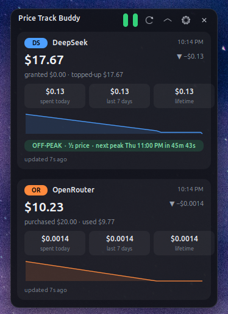
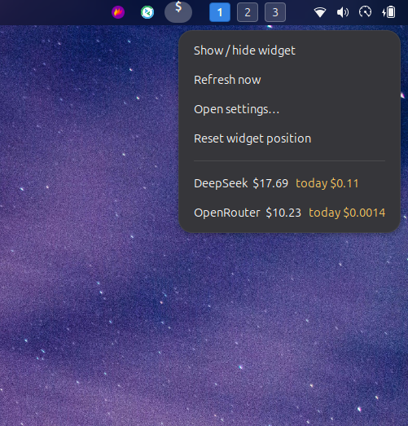

# Price Track Buddy

> **UNDER DEVELOPMENT.** Features may change and bugs will show up. Use it at
> your own risk, and report issues as you find them.

A floating panel I built for GNOME Shell 45 to 50. It keeps the balances and
spend from DeepSeek, OpenRouter, a LiteLLM proxy, or your own endpoints on
screen. And it remembers what you spend over time.

Built by Moss AI Studio · uuid `price-track-buddy@mossaistudio.com`



 - tested on
GNOME 50 / gjs 1.88 (Ubuntu 24.x, Wayland).

## What it does

The panel floats over your desktop, bottom right by default, and you can drag it
anywhere. The header holds the controls: refresh now, collapse, settings, hide.
The title area is the drag handle. Two status dots sit beside the title. Hover
one to see the provider.

Collapse it and it stays on screen in minimal mode: one compact row per enabled
provider with its provider badge, the current balance, and today's spend. The
outline turns green while DeepSeek is off-peak and orange during peak hours, the
same colours as the billing banner, so you can read the state without expanding
it. Expand it and you get a card per enabled provider. Turn every provider off
and the panel says so instead of showing an empty card area.

| DeepSeek card | OpenRouter card |
|---|---|
| Current total balance (`granted` + `topped-up` shown separately) | Credits remaining |
| Balance delta since the last reading (▲ spent / ▼ topped up) | Purchased vs. used credits |
| Spent today / last 7 days / lifetime (derived from balance deltas) | Same spend columns |
| 30-minute mini sparkline of the balance | Sparkline of credits |
| Peak / off-peak billing banner (Beijing-hours windows, live countdown) | - |

The look is yours to set.

An opacity slider runs from 20 to 100 percent, and Always on top keeps the panel
over fullscreen windows. Switch that off and a fullscreen window on the same
monitor will cover it.

A small `$` indicator in the top panel carries the same numbers. Its menu shows
or hides the widget, refreshes now, opens settings, resets the widget position,
and gives you a live one-line balance for each enabled provider. You can turn the
indicator off in settings.

Readings go to a local ledger, so history and "spent today" survive restarts.
History is capped at 480 points per provider, and older points get averaged
down.

The top-panel indicator carries the same live numbers.




## Requirements

- GNOME Shell 45-50 (gjs 1.74 or newer; built against gjs 1.88)
- Network access to `api.deepseek.com`, `openrouter.ai`, your LiteLLM proxy,
  and/or whichever endpoints you point the custom slots at

## Install

Clone the repo and check out the latest tagged release.

```bash
git clone https://github.com/DevTarlow/price-track-buddy.git
cd price-track-buddy
git checkout v0.1.0          # the latest release tag
./install.sh                 # → ~/.local/share/gnome-shell/extensions/
```

A tag checkout leaves you on a detached HEAD. That is expected. You are pinned
to a released snapshot instead of `main`. `git tag -l` lists the available tags,
and the [releases page](https://github.com/DevTarlow/price-track-buddy/releases)
says what changed in each one.

Then turn it on.

Use the Extensions app (`gnome-extensions-app`, preinstalled on Ubuntu) and
enable Price Track Buddy, or run `gnome-extensions enable
price-track-buddy@mossaistudio.com`.

On Wayland, enabling or disabling waits for your next log out and back in. On
X11, `Alt+F2`, then `r`.

## Update

Releases are tagged, so an update means moving to the new tag and running the
installer again. `install.sh` is the update step too. It copies the current
`extension.js`, `prefs.js`, `stylesheet.css`, `lib/*.js` and the schema into
`~/.local/share/gnome-shell/extensions/`, then recompiles `gschemas.compiled`,
which you need whenever a release adds or changes a setting.

```bash
cd price-track-buddy
git fetch --tags         # pick up releases tagged since you cloned
git tag -l               # list them, oldest first
git checkout v0.1.0      # the release you are moving to
./install.sh
```

Want the development tip instead of a release? Run
`git checkout main && git pull` before `./install.sh`. The tags are just the
snapshots that were released.

Then load the new code the same way as a fresh install. On Wayland, log out and
back in. On X11, `Alt+F2`, then `r`.

Your settings and history stay put.

Settings live in dconf (`/org/gnome/shell/extensions/price-track-buddy/`) and the
spend ledger in `~/.local/share/price-track-buddy/`. `install.sh` touches
neither.

## Configuration

Open Extensions, then Price Track Buddy, then the gear button. You can also use
the widget's gear icon or the indicator menu. There are two pages. Turning a
provider off hides its card, dot and menu line; the ledger is kept.

### Providers

| Setting | Notes |
|---|---|
| Track DeepSeek | Enable/disable polling DeepSeek |
| DeepSeek API key | `sk-…` key with balance permission |
| DeepSeek base URL | Optional; default `https://api.deepseek.com` |
| Preferred currency | Optional; pick one of the currencies the API reports (empty = first entry) |
| Track OpenRouter | Enable/disable polling OpenRouter |
| OpenRouter API key | Management key (`sk-or-v1-…`). A publishable key will get HTTP 401 |
| OpenRouter base URL | Optional; default `https://openrouter.ai/api/v1` |
| Track LiteLLM proxy | Enable/disable polling a LiteLLM proxy |
| LiteLLM base URL | Proxy root; default `http://localhost:4000` |
| LiteLLM API key | Virtual key with access to `/key/info` |
| Track custom endpoints | Three slots, each with its own enable switch |
| Custom endpoint name | Optional display name per slot (default "Custom endpoint N") |
| Custom endpoint URL | Full URL returning the JSON contract below |
| Custom endpoint API key | Bearer token or custom header; optional when auth is None |
| Custom endpoint auth | Bearer token, custom header, or none |
| Custom endpoint header | Header name used for the custom-header mode |
| Custom endpoint currency | Fallback when the JSON omits `currency` |

> [!WARNING]
> GSettings/dconf stores keys in plaintext on disk. Use a dedicated key, or a
> restricted/proxy endpoint as Base URL, if that bothers you.

### LiteLLM proxy

Point it at a LiteLLM proxy root and give it a virtual key. It reads
`/key/info` and shows the key's remaining budget when one is set, or the spend
when it is not. Spend comes from the change between readings.

OneAPI and NewAPI expose a different response shape and a deployment-specific
quota unit, so use the custom endpoint with a small proxy for those.

### Custom endpoints

There are three custom slots. Each points at one URL and returns JSON with a
numeric total and an optional currency:

```json
{ "currency": "USD", "total": 12.34 }
```

`balance` works in place of `total`. The URL is the full endpoint, not a base
URL. Authentication can be a Bearer token (the default), a single custom header,
or none. Each slot has its own Test endpoint button in settings to fetch once
and show the parsed total before you rely on it.

If your endpoint only knows cumulative spend, send it as `used` or `spent`
instead of `total` (or `balance`). The card then shows spend to date, and
today's spend comes from the delta between readings.

When the endpoint reports a balance, spend comes from the balance delta, same
as DeepSeek, so a drop counts as spend and a rise as a top-up. If the
endpoint's shape does not fit the contract, put a small proxy in front of it.

### General

| Setting | Notes |
|---|---|
| Refresh interval | 20-3600 s (default 60 s) |
| Show floating widget | Hides the panel (indicator still works) |
| Always on top | Keep the widget visible over fullscreen windows (off = a fullscreen window on its monitor covers it) |
| Widget opacity | 20-100 % panel opacity |
| Show top panel indicator | Hides the `$` indicator |
| Widget position | Reset to the bottom-right corner (drag to move) |

## Where the data lives

- **Settings**: `dconf` key
  `/org/gnome/shell/extensions/price-track-buddy/` (query with
  `gsettings list-recursively org.gnome.shell.extensions.price-track-buddy`)
- **Ledger history**: one JSON file per provider in
  `~/.local/share/price-track-buddy/` (`deepseek.json`, `openrouter.json`,
  `litellm.json`, `custom.json`, `custom2.json`, `custom3.json`). Delete a file
  to reset that provider's history.

## Reading the numbers

- Spend comes from the change between readings, not from invoices. Totals cover
  only the time since tracking began (the first reading seeds `trackedSince`).
- DeepSeek granted-balance expiry lowers the reported balance without an API
  call, so it looks like spend for that day. The card always shows `granted` and
  `topped-up` separately. If one day looks huge, compare those two before
  blaming usage.
- If DeepSeek reports a different currency than before, history resets so totals
  stay comparable, and the ledger re-seeds.
- Peak pricing: DeepSeek bills 1× price Mon-Fri 09-12 and 14-18 Beijing time, and
  0.5× otherwise (UTC windows 01-04 and 06-10 on weekdays; weekends are off-peak
  all day). The banner shows the current multiplier and a live countdown. The
  panel outline carries the same green/orange state colour.

## Troubleshooting

| Symptom | Fix |
|---|---|
| `API key rejected (401)` | Wrong key or URL. OpenRouter needs a *management* key; LiteLLM needs a virtual key. |
| `Not configured` / `No API key set` | Add the key in Settings. Polling is skipped until then. |
| `Network error` | Machine offline. It will retry on the next interval. |
| `malformed` on a custom endpoint | The URL must return JSON with a numeric `total`/`balance`, or `used`/`spent` for a spend-only endpoint. Use Test endpoint. |
| Panel doesn't appear after `gnome-extensions enable` | Log out and back in, or restart the Shell. Check `journalctl -f /usr/bin/gnome-shell` for JS errors. |
| GSettings key missing in prefs | Re-run `./install.sh` (it compiles `schemas/gschemas.compiled`). |

## Project layout

```
extension.js        shell entry point: settings → providers → ledgers → widget + indicator + polling
prefs.js            libadwaita preferences window (where keys are plugged in)
lib/providers.js    DeepSeek, OpenRouter, LiteLLM and custom-endpoint clients (libsoup3)
lib/registry.js     provider descriptors: identity, settings keys, movement mode, peak
lib/ledger.js       JSON ledger with daily buckets + capped point history
lib/peak.js         DeepSeek peak/off-peak window math (ported from DeepSeek Harness)
lib/widget.js       floating glass panel UI (drag, collapse, sparklines)
lib/format.js       money/duration/ago/error formatting
lib/http.js         libsoup3 GET wrapper (no Web fetch in gjs)
schemas/            GSettings schema (compiled to gschemas.compiled at install)
test/run-tests.mjs  gjs unit + integration tests:  gjs -m test/run-tests.mjs
```

## Development

```bash
node --check extension.js prefs.js lib/*.js   # syntax
gjs -m test/run-tests.mjs                     # 83 unit/integration tests
```

## Credits

Inspired by the `balance-buddy` plugin of
[DeepSeek Harness](https://github.com/deepseek-ai/DeepSeek-Harness)
(peak-window logic and ledger design). MIT-licensed.
